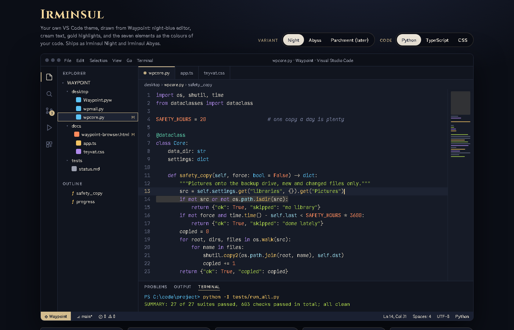

# Irminsul

A night-blue, cream and gold theme for VS Code, with the seven elements as the colours of your code. It also has a matching icon theme, an optional glow and an optional read-aloud command.



*The screenshot is an HTML mock-up of the theme (`docs/preview.html`) with made-up code.*

## The colours

Two main variants, **Night** and **Abyss**, each with a version tinted by one element (Pyro, Hydro, Anemo, Electro, Dendro, Cryo, Geo). That is 16 colour themes in all.

| Element | Colours in the code | Night | Abyss |
|---|---|---|---|
| Electro | keywords (`def`, `class`, `return`) | `#B18BEC` | `#D7A6FF` |
| Geo | functions | `#F2C463` | `#F2C463` |
| Dendro | strings | `#A8D04A` | `#9ED65B` |
| Pyro | numbers and constants | `#FF8A5C` | `#FF8F7A` |
| Hydro | types and classes | `#5CC4F5` | `#6FC8F7` |
| Cryo | properties and parameters | `#9FE0F0` | `#A9E3F1` |
| Anemo | decorators and special words | `#5FD3AE` | `#67D9B6` |

Comments are quiet and italic. The interface accent is gold (Night) or Electro purple (Abyss). There is also a Windows Terminal colour scheme file in `themes/windows-terminal-schemes.json`.

## Install

The easy way (no packaging needed): copy this folder to
`%USERPROFILE%\.vscode\extensions\shamilimanuel.irminsul-theme-0.1.0`, restart VS Code, press **Ctrl+K Ctrl+T** and pick an **Irminsul** theme. For the icons, open *File > Preferences > File Icon Theme* and pick **Irminsul Icons**.
To switch back, pick another theme the same way.

The theme files in `themes/` are generated. To change colours, edit `tools/build_themes.py` and run `python tools/build_themes.py`. `tools/check_contrast.py` checks that the text stays readable.

## Optional: the glow

`glow/irminsul-glow.js` adds a soft glow to function names and keywords and a gold glow to the cursor. It uses the **Custom CSS and JS Loader** extension.

**Warning:** that extension works by patching VS Code's own files. VS Code may then show a "your installation appears to be corrupt" message, and the patch can be undone by a VS Code update (you re-enable it afterwards). Use it only if you are fine with that. To switch the glow off: Ctrl+Shift+P, "Disable Custom CSS and JS", then restart VS Code. The theme itself works fine without the glow.

## Optional: read aloud

Command **Irminsul: Read aloud** (or **Ctrl+Alt+R**) reads your selection, or the whole file, out loud, and lights up the sentence being read. It runs fully on your PC.

The voices are **not included**. You download them yourself and each has its own licence, so check the terms before you use or share them:

- **Kokoro** (the "sky" voice): install the `kokoro-onnx` Python package into its own environment and download its model files (`kokoro-v1.0.onnx`, `voices-v1.0.bin`).
- **Piper** (the Dutch "Nathalie" and English "Lessac" voices): download `piper.exe` and the voice files.

Put them in `%LOCALAPPDATA%\Irminsul` like this (or set another folder in the *Irminsul* settings):

```
kokoro\venv\Scripts\python.exe
kokoro\kokoro-v1.0.onnx
kokoro\voices-v1.0.bin
piper\piper\piper.exe
piper\voices\nl_BE-nathalie-medium.onnx   (plus its .json file)
piper\voices\en_US-lessac-medium.onnx     (plus its .json file)
```

Settings: voice, speed, highlight on/off. Tests for this part run with plain Node: `node tests/test_speech.js` and `node tests/test_extension.js` (they use stand-in voices, nothing is downloaded).

## Files

`tools/` builds the themes and icons, `themes/` is the generated output, `icons/` the SVG icons, `src/` the read-aloud extension code, `glow/` the optional glow, `docs/` the preview pages.

Unofficial fan-made project, not affiliated with or endorsed by HoYoverse. Irminsul and the element names come from Genshin Impact.

## Licence

MIT, see [LICENSE](LICENSE). The voice models and the Custom CSS and JS Loader extension are separate projects with their own licences.

More projects: https://github.com/Shamilimanuel
